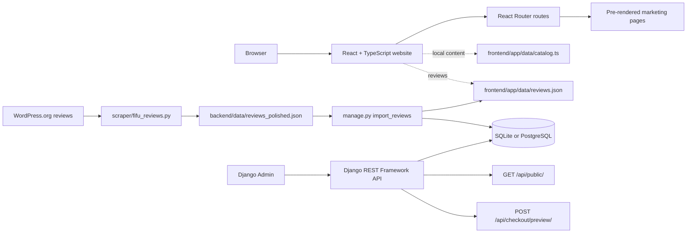

# DemoSuite — Website Demo for a Fictional WordPress Plugin

DemoSuite is a full-stack portfolio demo of a marketing website for a fictional WordPress plugin. **This repository contains the website demo, not an installable WordPress plugin.** It combines a **Django REST Framework API** with a **React, TypeScript, and React Router** frontend to demonstrate product pages, documentation, editorial content, search, pricing, and a simulated checkout.

The project is designed to show practical experience building a responsive web product across Python and JavaScript: Django models and API endpoints, server-rendered and pre-rendered React routes, SEO metadata, reusable UI, and server-side pricing calculations.

> **Demo only:** DemoSuite, its integrations, product screenshots, pricing, and legal copy are fictional examples. The reviews are genuine WordPress.org reviews shown with fictional reviewer names and placeholder portraits. The checkout does not collect payment information and does not process transactions.

## Project highlights

- **WordPress plugin marketing site:** homepage, feature catalog and detail pages, integrations, pricing comparison, customer-story examples, FAQ, documentation, blog, and policy pages.
- **SEO-oriented frontend:** React Router server rendering and pre-rendering for marketing routes, page-specific titles and descriptions, plus `robots.txt` and `sitemap.xml` files to configure for a real domain.
- **Searchable documentation:** filter guides by title and summary, with URL query state for shareable searches.
- **Django REST API:** public content endpoint and a pricing-preview endpoint built with Django REST Framework.
- **Pricing rules:** Python `Decimal` arithmetic, input validation, quantity limits, and multi-site discount tiers.
- **Content management:** Django Admin models and a seed command for fictional public content.
- **Responsive interface:** React components, custom CSS, Lucide icons, and illustrated WordPress admin previews.
- **Real WordPress.org reviews:** a standalone scraper, a hand-polished data set, a Django import with a sentiment flag, and a static JSON that the home page and `/reviews/` pre-render (see [Reviews from WordPress.org](#reviews-from-wordpressorg)).
- **Regression coverage:** Django tests for the reviews pipeline, Node unit tests for the review helpers, and focused end-to-end checks for the pre-rendered routes.

## Technology stack

| Area | Technologies |
| --- | --- |
| Backend | Python 3.11+, Django 5.2, Django REST Framework |
| Database | SQLite for local development; PostgreSQL support through `DATABASE_URL` |
| Frontend | React 19, TypeScript 5.8, React Router 7, Vite 6 |
| Styling and icons | Tailwind CSS 4 tooling, custom CSS, Lucide React |
| Local orchestration | Docker Compose |
| Frontend checks | Node.js test runner, Prettier |

## Architecture



The frontend is built and pre-renders the configured routes. The Django API and content models are available as a separate backend. **The frontend catalog is currently maintained in `frontend/app/data/catalog.ts`; there is not yet an automated content export or synchronization step from Django Admin to the static frontend.** This makes the current data boundary explicit and keeps the static build deployable without a running Node server.

## Run locally

### Requirements

- Python 3.11 or newer
- Node.js 22 or newer and npm
- Docker Compose is optional

### 1. Set up the Django API

From the project root:

```bash
python3 -m venv .venv
source .venv/bin/activate
python -m pip install -r backend/requirements.txt
cd backend
python manage.py migrate
python manage.py seed_demo
python manage.py runserver
```

The API runs at `http://127.0.0.1:8000`. To manage sample content, create a local admin account and open `http://127.0.0.1:8000/admin/`:

```bash
python manage.py createsuperuser
```

### 2. Run the React frontend

In a second terminal, from the project root:

```bash
cd frontend
npm ci
npm run dev
```

Open `http://localhost:5173`.

### Optional: Docker Compose

From the project root:

```bash
docker compose up --build
```

This starts the Django development server and Vite frontend. The first run installs dependencies inside the containers.

## API examples

### Read published demo content

```http
GET http://127.0.0.1:8000/api/public/
```

The response contains published content, brand settings, and a `fictional` flag. It is a public endpoint; do not put credentials or private content in its response.

### Preview a pricing quote

```bash
curl -X POST http://127.0.0.1:8000/api/checkout/preview/ \
  -H 'Content-Type: application/json' \
  -d '{"plan":"annual","quantity":5}'
```

The endpoint validates the plan and quantity and returns a USD quote. A five-site annual example applies the configured 5% volume discount. This is a pricing preview only; it is not connected to a payment provider.

## Build and checks

Build the frontend and generate its pre-rendered routes:

```bash
cd frontend
npm run build
```

Run the review helper unit tests and the focused route checks (the latter after building):

```bash
npm run test:unit
npm run test:e2e
```

Run the Django tests from `backend/` (they also validate the committed reviews data file and this README):

```bash
python3 manage.py test
```

Check formatting:

```bash
npm run format:check
```

The production build writes deployable frontend assets under `frontend/build/`. Configure static hosting or a CDN to serve each pre-rendered route correctly. The project has not been measured against production Lighthouse or field Core Web Vitals data.

## Reviews from WordPress.org

The home page and `/reviews/` show genuine 5-star reviews of the plugin, imported from its WordPress.org support forum. Reviewer identities are protected: the `@username` is stored only as a plain SHA-256 hash, each reviewer gets a fictional name, and portraits are replaced by a placeholder (or by an image you provide). Only the polished English text is stored; the raw scrape is never committed.

Each review has an editorial quality score from 0 to 10. Scores reward clear, specific comments that explain a useful feature or concrete impact; short generic praise and overly broad comments score lower. The public pages rank by score, with the original WordPress.org order breaking ties. Scores are subjective editorial judgments, not WordPress ratings.

### Pipeline

```text
WordPress.org ──scrape──▶ reviews_raw.json ──polish (by hand/AI)──▶ reviews_polished.json ──import──▶ SQLite ──export──▶ frontend/app/data/reviews.json ──npm run build──▶ pre-rendered pages
```

1. **Scrape.** `backend/scraper/fifu_reviews.py` is a standalone script (Python 3.7+, `pip install requests beautifulsoup4`) that walks every listing page, opens each topic, and writes the raw reviews. It waits **10 seconds** before every request so WordPress.org does not rate-limit it (a full run takes about 40 minutes).

   ```bash
   python fifu_reviews.py --limit 5 --out reviews_raw.json --cache-dir html_cache   # quick check
   python fifu_reviews.py --out reviews_raw.json --cache-dir html_cache             # full run
   python fifu_reviews.py --validate reviews_raw.json                               # self-check
   ```

   Options: `--limit N` stops after N new reviews; `--cache-dir` saves every fetched page and `--offline` re-parses from that cache without network; `--db path/to/db.sqlite3` reads the stored hashes so only new reviews are exported; `--delay` overrides the pause. Inside the project, `python3 manage.py scrape_reviews` wraps the same code and reads the database directly. **Abort rule:** when the number of stored reviews equals the 5-star count shown on WordPress.org, the run aborts with "no new reviews" before fetching any topic.

   Per review the scraper records the title, the full first post (the plugin author's replies are ignored), the relative date converted to weeks (**1 month = 4 weeks, 1 year = 48 weeks**, days are ignored), the absolute post date, and the listing position.

2. **Polish.** Translate and correct `reviews_raw.json` by hand into `backend/data/reviews_polished.json`: English only, one plain paragraph per comment (no line breaks, HTML, emojis or emoticons), no `@handles`, e-mail addresses or forum revision lines, a unique fictional name, and a `sentiment` of `positive`, `negative` or `neutral`. Assign each review a `quality_score` from 0 to 10: prioritize clear, specific feature use and concrete benefits; give short generic praise lower scores, and reserve 9–10 for unusually informative comments. The polished file is committed; the rules live in `backend/apps/reviews/polished.py`, and `python3 manage.py test` validates every one of them (cross-checking against the raw file when that is present).

3. **Import and export.** `python3 manage.py import_reviews` validates the polished file, upserts the reviews by hash into SQLite (stamping `scraped_at` from the file), and writes `frontend/app/data/reviews.json` with **only the positive reviews**, sorted by quality score from highest to lowest (then site order). Each entry carries the fictional name, title, comment, quality score, weeks, scrape timestamp and an avatar path. Re-running is safe and idempotent.

4. **Avatars.** Drop a 320×320 image named `<hash>.webp` into `frontend/public/images/reviews/` and re-run `python3 manage.py import_reviews --export-only`; reviews without an image use `placeholder.webp`. Use the same command after editing a review in Django Admin.

5. **Build.** `npm run build` bundles the JSON and pre-renders the pages. Review cards do not show review age.

`backend/data/reviews_raw.json` and `backend/data/html_cache/` are git-ignored.

## Search engine and launch checklist

Before deploying a rebranded site:

1. Replace the fictional brand, features, integrations, blog content, screenshots, prices, and legal language with verified information. The reviews are real (see above); only the names and portraits are substitutes.
2. Replace the example host in `frontend/public/robots.txt` and `frontend/public/sitemap.xml` with the production domain.
3. Add and verify canonical URLs and social-sharing metadata for the production domain.
4. Confirm that each page title and description matches its real content and search intent.
5. Configure production environment variables, allowed hosts, and `DEBUG=false`; never deploy with the local development secret key.
6. Connect a payment provider only through a secure backend flow. The current checkout is simulated and does not take payments.
7. If Django is the content source for the frontend, implement and document the export/build synchronization step before publishing content through Admin.

## Useful files

```text
backend/
  apps/content/                 Django content models, admin, API, and seed command
  apps/commerce/pricing.py      Server-side quote rules and discount tiers
  apps/reviews/                 Review model, polished-file validator, export, import/scrape commands, tests
  scraper/fifu_reviews.py       Standalone WordPress.org reviews scraper (no Django needed)
  data/reviews_polished.json    Translated, corrected reviews with fictional names (committed)
  config/settings.py            Django configuration
frontend/
  app/routes/                   React Router page components
  app/data/catalog.ts           Current frontend demo content
  app/data/reviews.json         Positive reviews exported by import_reviews (pre-rendered)
  app/data/reviews-utils.ts     Review age helpers (unit-tested)
  app/components/reviews/       ReviewCard used on the home page and /reviews/
  public/images/reviews/        Reviewer avatars (<hash>.webp) and placeholder.webp
  app/styles.css                Shared responsive design system
  public/                       Favicon, sample images, robots.txt, and sitemap.xml
  tests/site.e2e.mjs            Pre-rendered route regression checks
  react-router.config.ts        SSR and pre-render route configuration
```

## License

This project is licensed under the [MIT License](LICENSE). Third-party dependencies remain under their respective licenses.
